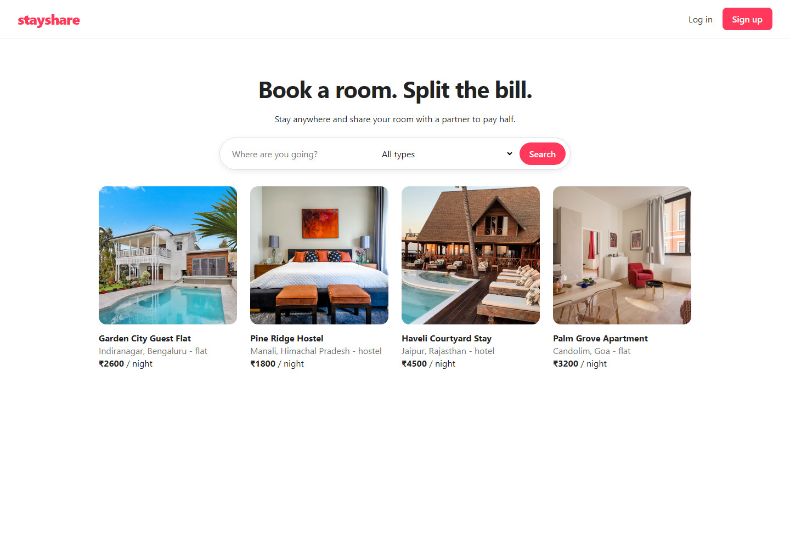
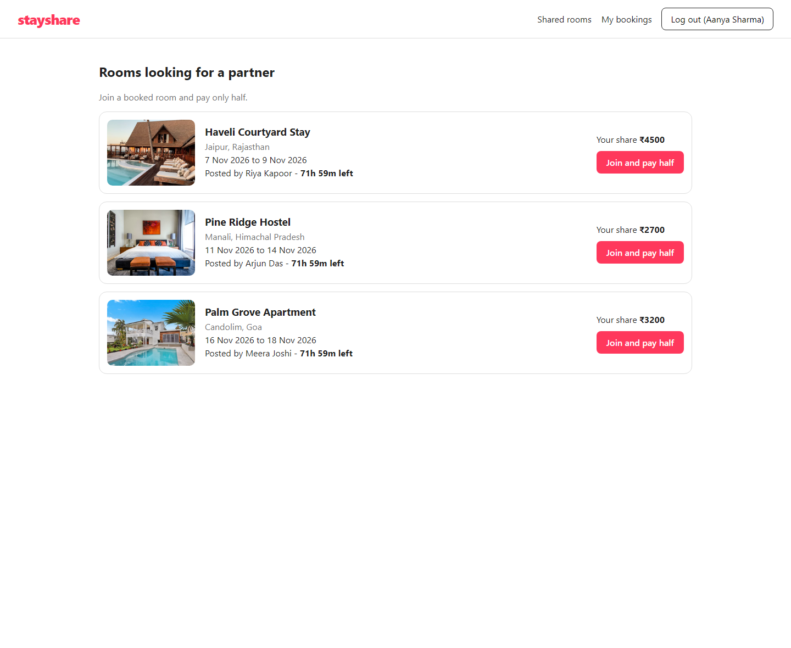
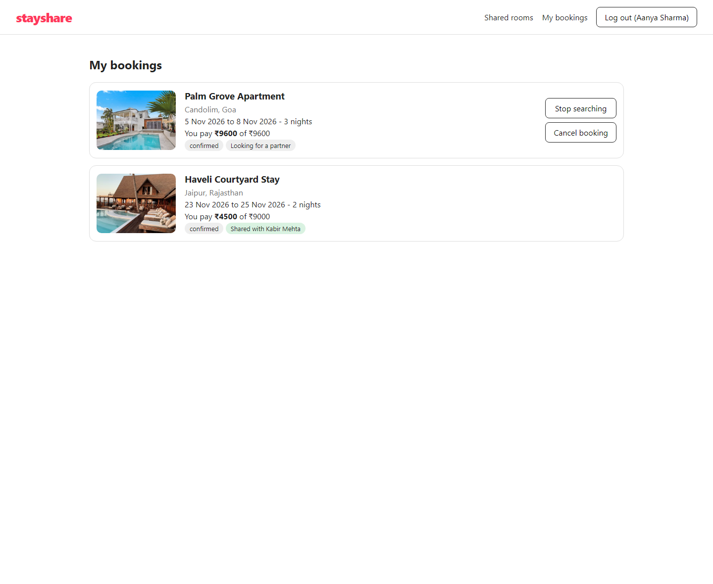
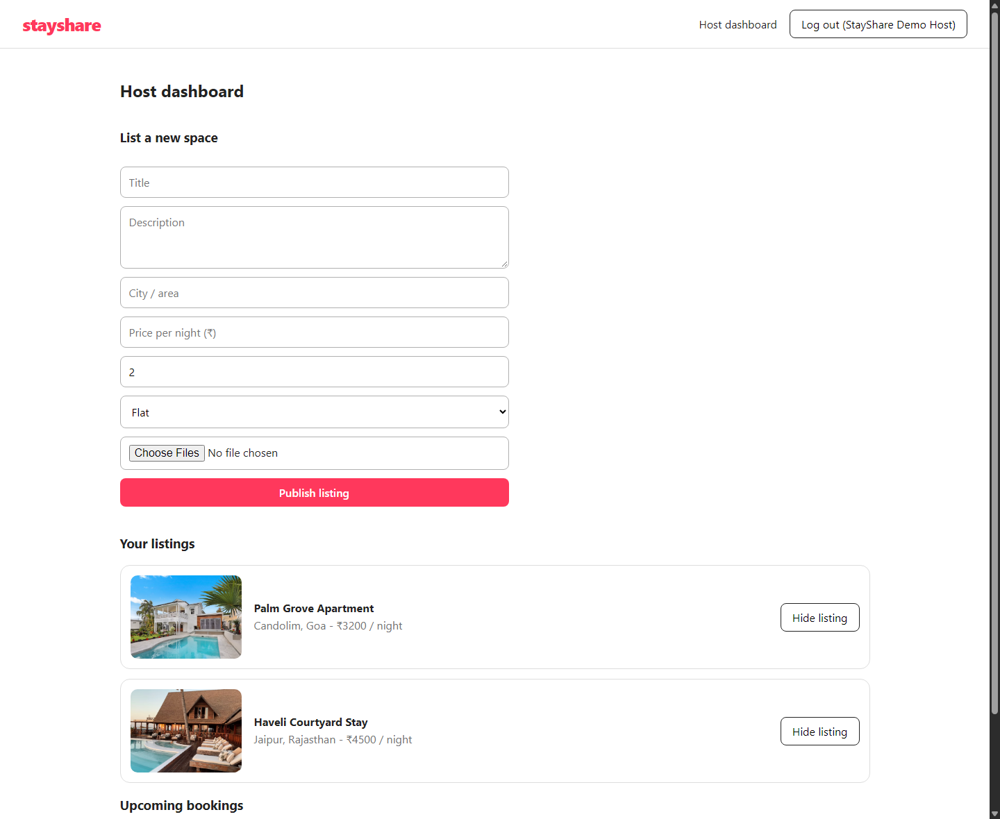
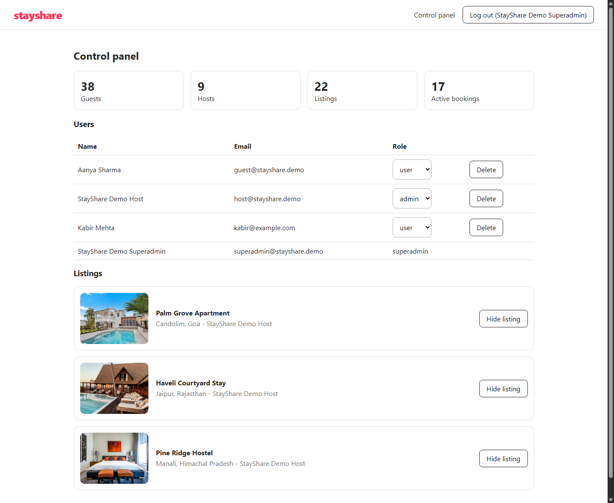
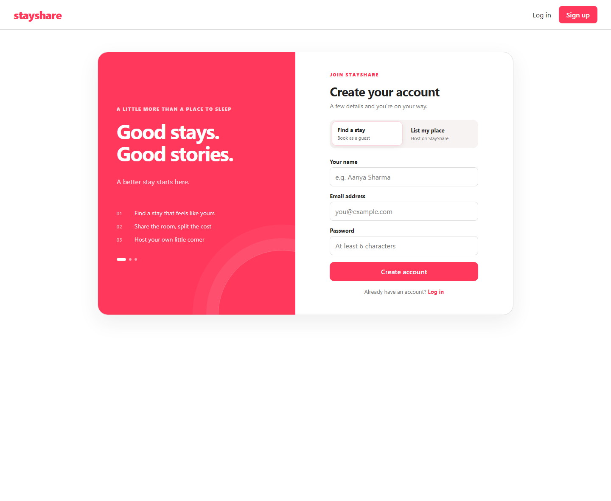

# StayShare

StayShare is a room booking app with an optional room sharing flow. Book a stay, share it with verified guests for up to 24 hours, and coordinate the split directly with the host if someone joins.



## A closer look

From browsing stays to sharing a room, managing a listing, or keeping an eye on the whole marketplace, these screens show the main StayShare flows.
Screenshots use representative sample listings and demo activity.

<table>
  <tr>
    <td width="50%" valign="top">
      
      <strong>Shared rooms</strong><br>
      Browse upcoming stays, see the price split, and join a room.
    </td>
    <td width="50%" valign="top">
      
      <strong>Your bookings</strong><br>
      Keep track of upcoming stays and see when a room has been shared.
    </td>
  </tr>
  <tr>
    <td width="50%" valign="top">
      
      <strong>Host dashboard</strong><br>
      Add a space, manage listings, and review upcoming bookings.
    </td>
    <td width="50%" valign="top">
      
      <strong>Marketplace control panel</strong><br>
      View activity, manage roles, and review listings in one place.
    </td>
  </tr>
  <tr>
    <td colspan="2" valign="top">
      
      <strong>Simple sign up</strong><br>
      Join as a guest or choose the host path to list a place.
    </td>
  </tr>
</table>

## What you can do

- Browse stays by location and property type.
- Book available dates and view upcoming bookings.
- Invite another guest to share a booking, or join an open request.
- List a flat, hotel, or hostel as a host and manage its bookings.
- Manage users, roles, and listings from the superadmin panel.

Bookings are reserved without online payment. Guests pay the host directly at check-in, and the host records the payment from the host dashboard.

## Built with

React, Vite, Express, MongoDB, Mongoose, and JWT authentication. Listing photos can use Cloudinary; without Cloudinary credentials, the backend stores uploads locally.

## Run it locally

You will need Node.js and a MongoDB database. A local MongoDB server or MongoDB Atlas connection works.

### 1. Set up the backend

```sh
cd backend
npm install
```

Copy `backend/.env.example` to `backend/.env` and set `MONGODB_URI`, `ACCESS_TOKEN_SECRET`, and `REFRESH_TOKEN_SECRET`. Use private random values for both token secrets. Cloudinary values are optional.

In PowerShell, copy the file with:

```powershell
Copy-Item .env.example .env
```

Add the sample listings and start the API:

```sh
npm run seed:demo
npm run dev
```

The sample seed can be run more than once; it will not add duplicate listings. To create demo sign-ins for a local showcase, make sure `.env` points to a development database, then set `$env:ENABLE_DEMO_ACCOUNTS = "true"` and run `npm run seed:demo:accounts` in PowerShell.

The demo account seed refuses to run with `NODE_ENV=production` and is opt-in because it creates a superadmin with a shared password and sample records. Do not use these demo credentials on a live database.

| Demo role | Email | Password |
| --- | --- | --- |
| Guest | `guest@stayshare.demo` | `StayShareDemo123!` |
| Host | `host@stayshare.demo` | `StayShareDemo123!` |
| Superadmin | `superadmin@stayshare.demo` | `StayShareDemo123!` |
| Guest with pending deletion request | `delete-request@stayshare.demo` | `StayShareDemo123!` |
| Host with pending deletion request | `delete-host@stayshare.demo` | `StayShareDemo123!` |
| Guest awaiting profile review | `pending-guest@stayshare.demo` | `StayShareDemo123!` |
| Host awaiting profile review | `pending-host@stayshare.demo` | `StayShareDemo123!` |

The opt-in account seed creates repeatable deletion and verification requests, pending/rejected/hidden listing examples, hotel room types, and an upcoming host booking. It can be rerun to restore this demo state. The sample booking is marked as paid for dashboard testing; no real payment is made. The regular demo listings include Goa, Jaipur, Manali, Bengaluru, New Delhi, and Chandigarh.
The login page has buttons to fill each demo account into the sign-in form. To create a private superadmin instead, set `SUPERADMIN_EMAIL` and a private `SUPERADMIN_PASSWORD` in `.env`, then run `npm run seed`.

### 2. Start the frontend

In a second terminal:

```sh
cd frontend
npm install
npm run dev
```

Open [http://127.0.0.1:5173](http://127.0.0.1:5173). Vite forwards API and local image requests to the backend on port 5000.

If PowerShell blocks the `npm` command, use `npm.cmd` in the commands above.

## Sharing flow

1. Open **My bookings** after reserving and choose **Share with network · 24 hours**.
2. The request is shown to verified guests with a matching profile, for up to 24 hours or until check-in, whichever comes first.
3. Review requests from **My bookings** and approve one guest. The amount is split between the two guests in the booking details.
4. Both guests pay the host directly at check-in; the host records the combined booking payment.

## Project layout

```text
backend/    Express API, MongoDB models, routes, and seed scripts
frontend/   React app and Vite configuration
screenshots/ README screenshots
```

## API overview

All API routes use the `/api/v1` prefix.

| Area | Routes |
| --- | --- |
| Auth | Register, login, refresh, logout, current user, and profile deletion requests |
| Properties | Browse, view, list, hide, restore, publish approved listings, and manage hotel room types |
| Bookings | Reserve stays with pay-at-check-in, record host-collected cash, view dates/bookings, and cancel |
| Shares | Open requests, create, join, and cancel requests |
| Superadmin | Stats, users, role updates, user removal, and profile deletion request review |

The backend health endpoint is `GET /api/health`.
## Account verification and approvals

New guest and host accounts require a password of at least 9 characters containing an uppercase letter, a lowercase letter, a number, and a special character, as well as a 10-digit phone number and gender. They then enter a manual review queue for the superadmin. Guests need an approved profile to book or apply to share a room. Hosts need approval before they can publish a listing. New hotel, hostel, and flat listings stay hidden until a superadmin approves them. Hosts can verify each booked guest at check-in during the booked stay and record check-out from the host dashboard.

Guests and hosts can submit a profile deletion request from **Account** and cancel it while it is pending. The superadmin can approve the request to permanently delete the profile or reject it; superadmin profiles cannot be deleted through this request flow.

Hosts submit new listings for superadmin approval, then publish or take approved listings offline from the host dashboard. Hotel listings can include multiple room types with individual nightly rates, guest capacities, and room counts. Room-type details are informational in this release; reservations continue to use the overall listing rate and availability.

Bookings confirm immediately and reserve the selected dates, but remain unpaid until the host records the payment in the host dashboard during the stay. The host must record payment before checking in the guest. Room sharing is unavailable for pay-at-check-in bookings because direct host payments cannot be split through the current sharing flow.

Room-share requests are reviewed by the guest who booked the stay. Applications are limited to matching gender profiles; the owner can approve one guest or reject an application from **My bookings**.

Guests who completed a stay can leave one 1–5 star review per booking. Listing cards and detail pages show average ratings and reviews. Use the **Dark** toggle in the top navigation to change themes; the selection is saved in the browser.

## Receipts and support contact setup

After the host records payment, StayShare opens a printable receipt page with the guest, booking dates, and amount. Hosts can add a property helpline and email in the host dashboard; those details appear on the receipt, with the host account contact as a fallback. When email delivery is configured, the same receipt is emailed to the guest.

To send booking emails, create a Resend API key and set `RESEND_API_KEY` and `MAIL_FROM` in `backend/.env`. Resend requires a sender address that is allowed for your account; verify a domain before sending to regular customers. Set `SUPPORT_EMAIL` and `SUPPORT_PHONE` in `backend/.env` for the receipt and email support details. Set the matching `VITE_SUPPORT_EMAIL` and `VITE_SUPPORT_PHONE` in `frontend/.env` so the Help & Support page can show them. Restart both servers after changing environment files. Email delivery is optional for local use; receipts remain available in the signed-in booking flow.

The **Help & Support**, **About**, and **User Agreement** pages are linked from the site footer. New account registration requires agreement acceptance. Unknown URLs open a small Snake game with keyboard and mobile touch controls, plus a link back to the stays page.

Hosts can see booking and collection totals alongside arriving guests’ contact details. For each guest, the host can confirm the guest at the property, mark check-in, then record check-out. Shared bookings show each guest separately.
"# STAYSHARE-MERN" 
